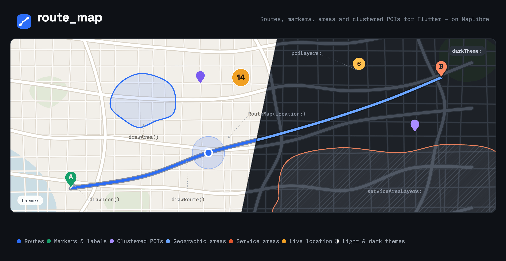

<p align="center">
  
</p>

# route_map

A Flutter map widget built on [`maplibre_gl`](https://pub.dev/packages/maplibre_gl)
for apps that draw things *on* a map: routes, themed markers, geographic areas,
clustered points of interest and coverage overlays.

You describe what should be on the map, `route_map` keeps it there — including
across style reloads and light/dark theme switches.

## Features

- **Routes** — polylines with an optional casing (back line), blur and join style.
- **Markers** — pin-shaped icons rendered from an SVG asset or a short text, with
  optional labels, rotation, anchors and drag support.
- **Circles** — screen-space circles that keep their pixel radius while zooming.
- **Areas** — multi-polygon fills with holes that keep their *geographic* size
  while zooming, including a `radius` helper for "reachable from here" shapes.
- **Clustered POI layers** — declarative GeoJSON overlays split into filtered
  categories, with cluster bubbles, labels, tap handling and visibility toggling.
- **Service areas** — shaded, optionally hatched regions drawn below everything
  else, for visualising gaps in coverage.
- **Native user location** — MapLibre's location indicator driven by location
  fixes your app already owns, with camera follow modes.
- **Camera control** — animate to a point or fit a set of points with padding,
  plus move/idle/tracking callbacks.
- **Light & dark themes** — every drawable takes a `theme` and an optional
  `darkTheme`, re-applied automatically when the platform brightness changes.
- **Survives style reloads** — everything you drew is restored after a style
  change, and controller calls made before the map is ready are queued.

## Requirements

| | Requirement |
|---|---|
| Flutter | `>= 3.29.0` |
| Dart SDK | `^3.8.0` |
| iOS | 13.0+ |
| Android | as required by `maplibre_gl` |
| Web | supported |

You need a MapLibre-compatible **style URL**. No API key is required for open
basemaps — the example app uses CARTO's Positron and Dark Matter styles.

> [!IMPORTANT]
> **Mapbox-hosted styles are not supported.** Use a MapLibre-compatible style
> (MapTiler, CARTO, Protomaps, your own tile server, …). See
> [flutter-maplibre-gl#149](https://github.com/maplibre/flutter-maplibre-gl/issues/149).

## Installation

```yaml
dependencies:
  route_map:
    git:
      url: https://github.com/tappeddev/route_map.git
      ref: main
```

```sh
flutter pub get
```

## Quick start

`RouteMap` renders the map; a `RouteMapController` draws on it. Keep the
controller alive for as long as the widget — create it in `initState` or as a
field, not inside `build`.

```dart
import 'package:flutter/material.dart';
import 'package:route_map/route_map.dart';

class MapPage extends StatefulWidget {
  const MapPage({super.key});

  @override
  State<MapPage> createState() => _MapPageState();
}

class _MapPageState extends State<MapPage> {
  final _controller = RouteMapController();

  @override
  Widget build(BuildContext context) {
    return RouteMap(
      controller: _controller,
      styleUrl: 'https://basemaps.cartocdn.com/gl/positron-gl-style/style.json',
      locale: 'en',
      initialCameraPosition: const CameraPosition(
        target: LatLng(48.137154, 11.576124),
        zoom: 12,
      ),
      // Padding kept free when the camera fits a set of points.
      zoomPadding: const EdgeInsets.all(48),
      minMaxZoomPreference: const MinMaxZoomPreference(4, 18),
      onMapClicked: (_, latLng) => debugPrint('tapped $latLng'),
    );
  }
}
```

Every `route_map` type, plus the MapLibre types you need (`LatLng`,
`CameraPosition`, `LatLngBounds`, `MinMaxZoomPreference`, `CameraTargetBounds`,
`GeojsonSourceProperties`, `ManualLocationUpdate`, …) is exported from the single
`package:route_map/route_map.dart` import.

## Drawing on the map

Every drawable carries an `identifier`. That identifier is your handle: draw with
the same one again to replace, pass it to a `remove*` method to delete. Controller
calls are safe to make immediately — they wait until the map's style is ready.

### Routes

`RouteMapRouteTheme.backLineWidth` + `backLineColor` draw a wider line *beneath*
the main one, which is how you get the usual outlined-route look.

```dart
await _controller.drawRoute(
  route: const RouteMapRoute(
    identifier: 'trip',
    points: [LatLng(47.7826, 9.6106), LatLng(48.1371, 11.5754)],
    theme: RouteMapRouteTheme(
      lineWidth: 5,
      color: Color(0xFF2B6CF6),
      backLineWidth: 8,
      backLineColor: Colors.black26,
      lineJoin: 'round',
    ),
    darkTheme: RouteMapRouteTheme(
      lineWidth: 5,
      color: Color(0xFF6AA5FF),
      backLineWidth: 8,
      backLineColor: Colors.black54,
    ),
  ),
  animateCamera: true,
);

await _controller.removeRoutes();
```

### Markers

A marker is a `markerPath` (the pin silhouette, any `dart:ui` `Path`) filled with
`theme.background`, containing **either** an SVG icon **or** a short text — not
both.

```dart
await _controller.drawIcon(
  RouteMapIcon(
    identifier: 'pickup',
    latLng: const LatLng(48.1371, 11.5754),
    markerPath: Path()..addOval(const Rect.fromLTWH(0, 0, 36, 36)),
    svgIconPath: 'assets/icons/pin.svg',
    label: 'Pickup',
    anchor: RouteMapIconAnchor.bottom,
    draggable: true,
    theme: const RouteMapIconTheme(
      background: Color(0xFF15A06A),
      foreground: Colors.white,
      drawCircleAroundIcon: true,
      strokeWidth: 2,
      padding: 4,
    ),
  ),
);
```

- `svgIconPath` is loaded with `rootBundle`, so it must be a **declared Flutter
  asset** in your app's `pubspec.yaml`.
- `theme.foreground` recolors the SVG's `fill` / `stroke`. Pass `null` to keep the
  SVG's own colors — useful for multi-color brand icons. It must be non-null when
  you use `text`.
- `label` is a separate text field rendered next to the pin, independent of `text`.
- Rendered pins are cached by their *visual* properties, so many markers that look
  alike share one rasterised image.

Removal is available per-icon, by predicate, or wholesale:

```dart
await _controller.removeIcon('pickup');
await _controller.removeIconsWhere((icon) => icon.identifier.startsWith('stop_'));
await _controller.removeIcons();
```

### Circles

`RouteMapCircle` has a radius in **screen pixels**, so it stays the same size as
you zoom.

```dart
await _controller.drawCircle(
  const RouteMapCircle(
    identifier: 'vehicle',
    latLng: LatLng(48.137, 11.576),
    theme: RouteMapCircleTheme(
      radius: 8,
      color: Color(0xFF2B6CF6),
      strokeWidth: 2,
      strokeColor: Colors.white,
    ),
  ),
);

await _controller.removeCircle('vehicle');
await _controller.removeCircles();
```

### Areas

`RouteMapArea` is the geographic counterpart: it keeps its real-world size while
zooming. An area holds several polygons, each of which may have holes — useful
when a radius is clipped by a region border. Opacity comes from the alpha channel
of the theme colors.

```dart
await _controller.drawArea(
  RouteMapArea(
    identifier: 'reachable',
    polygons: [
      RouteMapAreaPolygon.radius(
        center: const LatLng(48.137, 11.576),
        radiusInMeters: 2500,
      ),
      const RouteMapAreaPolygon(
        outline: [/* … */],
        holes: [[/* … */]],
      ),
    ],
    theme: RouteMapAreaTheme(
      fillColor: const Color(0xFF2B6CF6).withValues(alpha: 0.13),
      borderColor: const Color(0xFF2B6CF6),
      borderWidth: 2,
    ),
    // Keep the basemap's labels readable on top of the fill.
    belowLayerId: 'place_label',
  ),
);

await _controller.removeArea('reachable');
await _controller.removeAreas();
```

Outlines do not need to be closed — the first point is repeated for you.

## Theming and dark mode

Routes, icons, circles, areas, POI categories and cluster bubbles each accept a
`theme` and an optional `darkTheme`. `route_map` reads the **platform brightness**
and re-themes everything it has drawn when that changes, so you do not redraw
anything yourself.

```dart
RouteMapIcon(
  // …
  theme: const RouteMapIconTheme(background: Colors.white, foreground: Colors.black),
  darkTheme: const RouteMapIconTheme(background: Colors.black, foreground: Colors.white),
)
```

Omitting `darkTheme` means the light theme is used in both modes. Pair this with a
dark style URL to switch the basemap at the same time:

```dart
styleUrl: Theme.of(context).brightness == Brightness.dark
    ? 'https://basemaps.cartocdn.com/gl/dark-matter-gl-style/style.json'
    : 'https://basemaps.cartocdn.com/gl/positron-gl-style/style.json',
```

Changing `styleUrl` tears down and rebuilds the style; `route_map` reinstalls your
service areas, POI layers, map language and all drawn geometry afterwards.

## Camera

```dart
// Fit a set of points, using `zoomPadding` unless overridden.
await _controller.animateCameraTo(points: route.points);
await _controller.animateCameraTo(points: stops, padding: const EdgeInsets.all(80));

// Move to a single target, optionally changing zoom / bearing / tilt.
await _controller.animateCameraToTarget(
  target: const LatLng(48.137, 11.576),
  zoom: 16,
  tilt: 45,
  duration: const Duration(milliseconds: 800),
);

final position = await _controller.getCameraPosition();
```

`drawRoute`, `drawIcon`, `drawCircle` and `drawArea` all take `animateCamera` to
fit what you just drew in one call.

> [!NOTE]
> Set `trackCameraPosition: true` if you use `animateCameraToTarget` without
> passing an explicit `zoom` / `tilt`, or if you read `getCameraPosition()`.
> Without tracking, MapLibre keeps reporting the *initial* camera position, and
> the omitted values would snap back to it.

Constrain and observe the camera with:

| Property | Purpose |
|---|---|
| `initialCameraPosition` | starting target and zoom |
| `minMaxZoomPreference` | clamp the zoom range |
| `cameraTargetBounds` | restrict panning to a bounding box |
| `zoomPadding` | default padding for `animateCameraTo` |
| `tiltGesturesEnabled` | opt into perspective gestures (not every style supports 3D) |
| `onCameraMoveStarted` / `onCameraMove` / `onCameraIdle` | movement callbacks |

`onCameraMove` only fires while `trackCameraPosition` is `true`.

## User location

Pass the current fix to `RouteMap.location`. `route_map` forwards updates to
MapLibre as the widget rebuilds:

```dart
RouteMap(
  location: currentLocation, // ManualLocationUpdate?
  myLocationRenderMode: MyLocationRenderMode.compass,
  myLocationTrackingMode: MyLocationTrackingMode.trackingGps,
  onCameraTrackingDismissed: () => setState(() => _followUser = false),
  // …other map options
)
```

If your app has its own location model, convert it at the boundary:

```dart
ManualLocationUpdate(
  target: LatLng(fix.latitude, fix.longitude),
  horizontalAccuracy: fix.accuracy, // metres
  bearing: fix.heading, // direction of travel in degrees
  speed: fix.speed, // metres per second
  timestamp: fix.timestamp,
)
```

A non-null `location` enables the native indicator automatically; `null` hides it.
Visibility and the manual location source are managed internally. The latest fix
is applied once the style has loaded and restored after style changes, and
intermediate fixes received while loading or sending are coalesced.

> [!IMPORTANT]
> Rebuilding with the *same* fix instance does not resend it. Provide a new
> instance for every observation, including accuracy-only or timestamp-only
> changes.

MapLibre draws the indicator and its accuracy visualization natively. It does not
request location permission or start its own device-location engine in manual
mode: your app owns the provider, its permissions and its subscription lifecycle.
`location` is a plain widget property, so any state-management approach works —
`route_map` never subscribes to anything.

Use `myLocationTrackingMode` and `myLocationRenderMode` to configure native camera
following and indicator rendering; both are applied only while `location` is
non-null. `onCameraTrackingChanged` reports every tracking change (including
`MyLocationTrackingMode.none` when `location` becomes `null`), while
`onCameraTrackingDismissed` fires when a user gesture breaks the follow.

`MyLocationRenderMode.gps` — the arrow that points in the direction of travel —
is Android-only. On iOS MapLibre logs `RenderMode.GPS currently not supported`
and keeps the plain dot.

### Styling the native indicator (Android)

The indicator is drawn by the native SDK, so neither `route_map` nor `maplibre_gl`
exposes its colours, size or shadow as Dart properties. On Android you can still
restyle it, because `maplibre_gl` builds its options from an Android **style
resource**:

```java
// maplibre_gl: MapLibreMapController.java
LocationComponentOptions.builder(context)
// maplibre-native: LocationComponentOptions.java
//   builder(context) -> createFromAttributes(context, R.style.maplibre_LocationComponent)
```

Android resource merging makes an app-level resource win over a library one of the
same name, so declaring `maplibre_LocationComponent` in your app replaces the
SDK's and `maplibre_gl` picks it up automatically — no plugin change needed.

```xml
<!-- android/app/src/main/res/values/maplibre_location_component.xml -->
<resources>
    <style name="maplibre_LocationComponent">
        <item name="maplibre_foregroundDrawable">@drawable/maplibre_user_icon</item>
        <item name="maplibre_backgroundDrawable">@drawable/maplibre_user_stroke_icon</item>
        <item name="maplibre_bearingDrawable">@drawable/maplibre_user_bearing_icon</item>
        <item name="maplibre_gpsDrawable">@drawable/maplibre_user_puck_icon</item>

        <item name="maplibre_foregroundDrawableStale">@drawable/maplibre_user_icon_stale</item>
        <item name="maplibre_backgroundDrawableStale">@drawable/maplibre_user_stroke_icon</item>

        <!-- Draw the puck smaller: the scale is interpolated linearly between
             the map's min and max zoom. The SDK defaults are 0.6 and 1. -->
        <item name="maplibre_minZoomIconScale">0.5</item>
        <item name="maplibre_maxZoomIconScale">0.8</item>

        <item name="maplibre_accuracyColor">@color/maplibre_location_layer_blue</item>
        <item name="maplibre_accuracyAlpha">0.15</item>
        <item name="maplibre_elevation">12dp</item>

        <item name="maplibre_enableStaleState">true</item>
        <item name="maplibre_staleStateTimeout">30000</item>
    </style>
</resources>
```

> [!IMPORTANT]
> A same-name style **replaces** the SDK's rather than inheriting from it, and
> `createFromAttributes` resolves every attribute you omit to its own default —
> the drawable attributes default to `-1`, i.e. no icon. Copy the SDK's style in
> full and change only the items you care about, and re-check it when
> `maplibre_gl` bumps the native SDK.

Attributes you can set this way (full list in `attrs.xml`, see below):

| Group | Attributes |
|---|---|
| Icons | `maplibre_foregroundDrawable`, `maplibre_backgroundDrawable`, `maplibre_bearingDrawable`, `maplibre_gpsDrawable` |
| Tints | `maplibre_foregroundTintColor`, `maplibre_backgroundTintColor`, `maplibre_bearingTintColor` |
| Stale state | `maplibre_enableStaleState`, `maplibre_staleStateTimeout`, `maplibre_foregroundDrawableStale`, `maplibre_backgroundDrawableStale`, `maplibre_foregroundStaleTintColor`, `maplibre_backgroundStaleTintColor` |
| Accuracy circle | `maplibre_accuracyColor`, `maplibre_accuracyAlpha`, `maplibre_accuracyAnimationEnabled` |
| Size & shadow | `maplibre_minZoomIconScale`, `maplibre_maxZoomIconScale`, `maplibre_elevation`, `maplibre_iconPadding{Left,Top,Right,Bottom}` |
| Animation | `maplibre_trackingAnimationDurationMultiplier`, `maplibre_compassAnimationEnabled` |
| Tracking thresholds | `maplibre_trackingInitialMoveThreshold`, `maplibre_trackingMultiFingerMoveThreshold` |
| Pulsing circle | `maplibre_pulsingLocationCircleEnabled`, `…FadeEnabled`, `…Color`, `…Duration`, `…Radius`, `…Alpha` |
| Stacking | `maplibre_bearing_on_top` |

Three attributes are declared but will not do what you expect:

- **`maplibre_trackingGesturesManagement`** is overwritten with `true` by
  `maplibre_gl` after the style is read, so the XML value is ignored.
- **`maplibre_layer_above` / `maplibre_layer_below`** are also set in code, to the
  topmost layer of the loaded style. Setting `maplibre_layer_below` yourself makes
  both present, and `LocationComponentOptions.build()` throws
  `IllegalArgumentException: You cannot set both layerAbove and layerBelow`.
- **`maplibre_pulsingLocationCircleInterpolator`** exists in `attrs.xml` but
  `createFromAttributes` never reads it, so it is a no-op from XML.

`maplibre_accuracyAlpha` must be between `0` and `1` and `maplibre_elevation` must
be `>= 0`, or `build()` throws.

To enlarge only the arrow without enlarging the disc, copy the SDK's
`maplibre_user_puck_icon` vector drawable, wrap its arrow `<path>` in a `<group>`
with `android:scaleX` / `scaleY` and a pivot at the centre, and point
`maplibre_gpsDrawable` at your copy.

**Reference** — `maplibre_gl` 0.27.1 pins `org.maplibre.gl:android-sdk-opengl:13.5.0`,
so match these to that tag:

- [Default `maplibre_LocationComponent` style](https://github.com/maplibre/maplibre-native/blob/main/platform/android/MapLibreAndroid/src/main/res/values/styles.xml) — the style to copy
- [`attrs.xml`, `declare-styleable maplibre_LocationComponent`](https://github.com/maplibre/maplibre-native/blob/main/platform/android/MapLibreAndroid/src/main/res/values/attrs.xml) — every attribute and its format
- [`LocationComponentOptions.java`](https://github.com/maplibre/maplibre-native/blob/main/platform/android/MapLibreAndroid/src/main/java/org/maplibre/android/location/LocationComponentOptions.java) — per-attribute docs, defaults and validation
- [`LocationComponentOptions` API reference](https://maplibre.org/maplibre-native/android/api/-map-libre%20-native%20-android/org.maplibre.android.location/-location-component-options/index.html)
- [Location component guide](https://github.com/maplibre/maplibre-native/blob/main/platform/android/docs/location-component.md)

There is no iOS equivalent. `maplibre_gl` 0.27.1 uses `MapLibre` 6.28.0 and only
toggles `showsUserLocation` / `showsUserHeadingIndicator`; restyling the iOS dot
needs `MLNMapView.tintColor` or a custom `userLocationAnnotationViewClass`, neither
of which is reachable from Dart.

## POI layers

A `RouteMapPoiLayer` is a declarative wrapper around one GeoJSON source plus the
symbol and circle layers rendered from it. Each **category** filters the source's
features and gives them their own pin, so one source can render several kinds of
place.

```dart
RouteMap(
  // …
  poiLayers: [
    RouteMapPoiLayer(
      identifier: 'service-points',
      createSource: () async => const GeojsonSourceProperties(
        data: servicePointsGeoJson,
        cluster: true,
        clusterRadius: 50,
        clusterMaxZoom: 14,
      ),
      clusterTheme: const RouteMapPoiClusterTheme(
        circleColor: Color(0xFFF0A023),
        circleStrokeColor: Colors.white,
        textColor: Colors.black,
        darkCircleColor: Color(0xFFFFC14D),
      ),
      categories: [
        RouteMapPoiCategory(
          identifier: 'workshop',
          filter: ['==', ['get', 'type'], 'workshop'],
          markerPath: Path()..addOval(const Rect.fromLTWH(0, 0, 32, 32)),
          svgIconPath: 'assets/icons/workshop.svg',
          interactive: true,
          theme: const RouteMapIconTheme(
            background: Color(0xFF7A5AF0),
            foreground: Colors.white,
          ),
          label: const RouteMapPoiCategoryLabel(
            textExpression: ['get', 'name'],
            color: Color(0xFF3A3A3A),
            haloColor: Colors.white,
          ),
        ),
      ],
    ),
  ],
  onPoiTapped: (event) => showDetails(event.categoryIdentifier, event.featureId),
)
```

```dart
await _controller.setPoiLayerVisibility(
  identifier: 'service-points',
  isVisible: false,
);
```

Worth knowing:

- `createSource` is async and may be called again when the style reloads, so it can
  read from disk or the network.
- `clusterTheme` only takes effect when the source you return is itself configured
  with `cluster: true`. Without it you get no cluster bubbles and no warning.
- Only categories with `interactive: true` trigger `onPoiTapped`. The callback
  receives the layer identifier, category identifier, raw feature id and tap
  position.
- Clustered features are excluded from category layers automatically, so a place
  is never drawn twice.
- `belowLayerId` inserts the whole layer below a style layer of your choice.

## Service areas

`serviceAreaLayers` shades regions — typically the parts of the map you *don't*
serve. The fill is drawn below all annotations, so routes and markers stay fully
visible on top.

```dart
RouteMap(
  // …
  serviceAreaLayers: [
    ServiceAreaLayer(
      createSource: () async =>
          const GeojsonSourceProperties(data: coverageGeoJson),
      fillColor: Colors.grey.withValues(alpha: 0.45),
      hashLines: const ServiceAreaHashLines(color: Colors.black26, spacing: 10),
      border: ServiceAreaBorder(
        createSource: () async =>
            const GeojsonSourceProperties(data: coverageOutlineGeoJson),
        color: Colors.redAccent,
        width: 2,
      ),
    ),
  ],
)
```

The border takes its own source so you can outline a different geometry than the
one you fill.

## Interaction

```dart
RouteMap(
  // …
  onMapClicked: (point, latLng) { /* screen point + geographic position */ },
  onFeatureDrag: (identifier, current, origin, eventType) { /* draggable icons */ },
  onFeatureHover: (identifier, latLng, eventType) { /* web only */ },
  allowIconsOverlap: true,
  ignoreIconsPlacement: true,
)
```

- `onFeatureDrag` reports icons created with `draggable: true`.
- `onFeatureHover` is only wired up on web, where pointer hover exists.
- `allowIconsOverlap` lets your icons draw even when they collide with symbols
  already placed.
- `ignoreIconsPlacement` stops icons from reserving space, so basemap POIs
  underneath stay visible. It currently applies to `poiLayers` symbols.

### Maps inside scrollables

A platform view only receives the gestures nobody else claims, so a map inside a
scrollable page or a draggable sheet loses vertical drags to its parent. Claim
them explicitly:

```dart
RouteMap(
  // …
  gestureRecognizers: {Factory<OneSequenceGestureRecognizer>(
    () => EagerGestureRecognizer(),
  )},
)
```

This affects iOS and Android only; on web the map receives events directly.
`Factory` comes from `package:flutter/foundation.dart` and
`EagerGestureRecognizer` from `package:flutter/gestures.dart`.

## Example app

The `example/` directory is a runnable app covering manual location, routes with
markers, and a map embedded in a draggable bottom sheet.

```sh
cd example
flutter run
```

## Contributing

```sh
flutter pub get
flutter analyze
flutter test

# generated files are excluded from the format check, as in CI
dart format $(find . -name '*.dart' ! -name '*.g.dart' ! -name '*.freezed.dart')

# after changing a @freezed model
dart run build_runner build --delete-conflicting-outputs
```

CI runs analyze, a format check and the test suite on every pull request — see
[`.github/workflows/check.yml`](.github/workflows/check.yml).

Bugs and feature requests belong in
[GitHub issues](https://github.com/tappeddev/route_map/issues).

## License

[0BSD](LICENSE)
